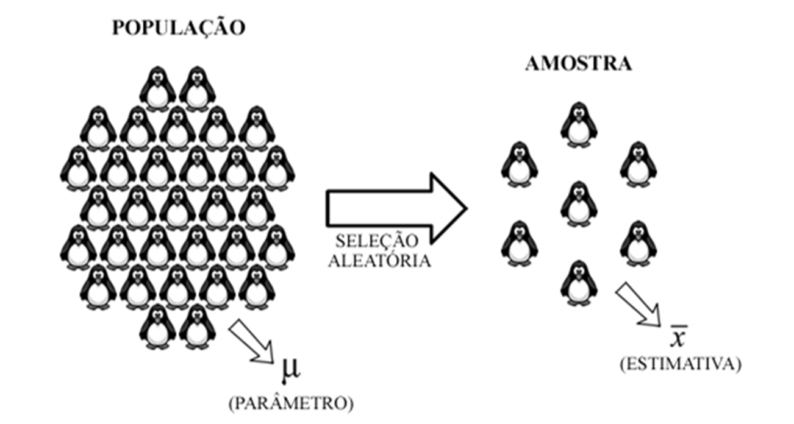

# CAPÍTULO 1 - INTRODUÇÃO E CONCEITOS BÁSICOS

A estatística é uma ciência autônoma, muitas vezes considerada erroneamente como um ramo da matemática. Teve sua origem na administração pública, em que era aplicada pelo Estado com o objetivo de coletar dados demográficos e econômicos da população para taxação de impostos e fins militares. No início do século XIX, a coleta de dados foi intensificada e, assim, o significado da estatística passou a ser mais abrangente de modo a incluir a coleta, organização, descrição, análise e interpretação de dados. Atualmente, a estatística é considerada como a arte de aprender com os dados, pois permite transformar grandes quantidades de dados em informações, que podem auxiliar na tomada de decisão e no estabelecimento de estratégias de gestão e controle de qualidade.

O termo “estatística”, bem como o seu significado e origem, geram opiniões controversas entre pesquisadores. Dentre alguns significados interessantes na literatura, Peuchet (1805), em seu livro “Statistique élémentaire de la France”, destaca que a palavra “estatística” pode ter sido derivada de duas palavras latinas: *statera* que significa “balança”, pela razão de que a estatística permite medir o poder de produção e riqueza de um país e, assim, compará-lo a momentos anteriores, ou *status* que significa “Estado”, devido a retratar a condição do Estado. A última sugestão tem sido mais aceita, pois é também da qual se deriva a palavra alemã *Statistik* (JOHN, 1883).

Embora a etimologia retrate o surgimento recente da palavra “estatística” em diversas línguas, há indícios de que 3000 A.C. já se faziam censos na Babilônia, China e Egito. O imperador César Augusto, por exemplo, ordenou que se fizesse o censo de todo império romano. A palavra “censo” é derivada do latim *censere*, que significa taxar. O censo ou recenseamento demográfico é um estudo estatístico no qual participam todos os indivíduos de uma população, diferente da pesquisa por amostragem, na qual apenas uma parcela representativa da população é utilizada para oferecer conclusões válidas sobre a população total.

No Brasil, o censo demográfico é realizado a cada 10 anos pelo Instituto Brasileiro de Geografia e Estatística (IBGE), tendo como objetivo principal coletar informações imprescindíveis para a definição de políticas públicas e a tomada de decisões de investimentos da iniciativa privada ou de qualquer nível de governo.

---

## 1.1. População e Amostra

**Definição 1.1.** População é o conjunto ao qual pertencem todos os elementos cujas características sejam de interesse.

**Definição 1.2.** Amostra é um subconjunto finito de uma população.

**Definição 1.3.** Um elemento ou membro de uma população ou amostra representa um sujeito ou item específico sobre o qual a informação é coletada.

Uma população, por exemplo, pode ser considerada tanto como o conjunto de todos os pinguins de uma espécie encontrados na Antártida, como o conjunto de pinguins dessa mesma espécie encontrado em uma ilha adjacente. Uma amostra representativa de uma dessas populações consiste de um subconjunto de pinguins selecionados aleatoriamente por um processo de amostragem.

As medidas estatísticas de características pertencentes aos elementos da população são denominadas “parâmetros”, que em geral são desconhecidos, já as obtidas com base em amostras são chamadas de “estimativas”. Na figura 1, apresentamos o parâmetro $\mu$ que, por convenção, expressa o valor da média populacional para uma determinada característica, e sua estimativa $\bar{x}$, que consiste do valor da média amostral.

Quando a amostra é suficientemente grande e obtida por meio da técnica correta, as estimativas refletem valores muito próximos aos dos parâmetros. O erro cometido na extrapolação de resultados pode ser controlado por meio da margem de erro (quantidade de erro amostral aleatório, ou seja, a diferença entre os dados da amostra e os dados reais) e do nível de confiança (percentagem de intervalos que incluiriam o parâmetro populacional, caso amostras da população fossem tomadas repetidas vezes).

A determinação do tamanho de uma amostra é um tópico complexo na amostragem, pois requer familiaridade com diversos conceitos estatísticos. Não existe uma quantidade pré-estabelecida para o tamanho amostral, pois cada estudo possui um objetivo e uma população alvo inerente e, assim, requer um método específico de cálculo. Dessa forma, esse assunto não será explorado neste livro.
