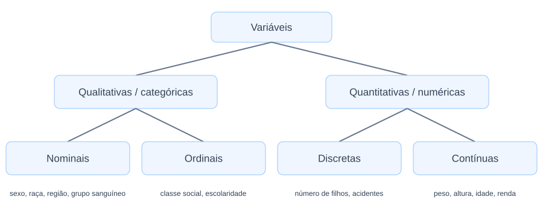
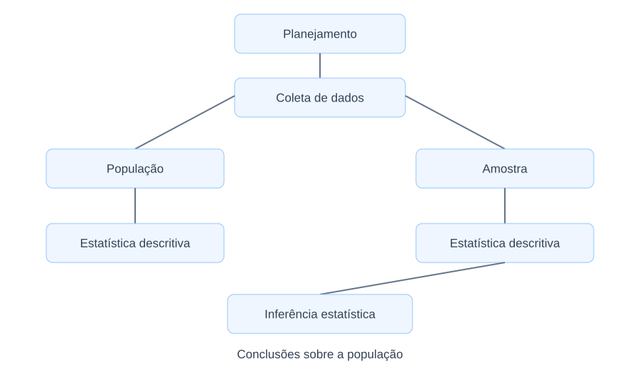

# 1.3. Tipos de variáveis

Ao estudar uma população, coletam-se informações a respeito de características de interesse, as quais são chamadas de “variáveis” em estatística. Elas tendem a possuir diferentes valores entre os elementos de uma população e são representadas por letras arábicas maiúsculas ($X, Y, Z, \dots$). São exemplos de variáveis: peso, estatura, sexo, nível de escolaridade, tempo de vida, dentre outras.

**Definição 1.4.** Uma variável corresponde a uma característica de interesse na população sob estudo, podendo assumir valores diferentes entre os elementos.

**Definição 1.5.** O valor de uma variável para um elemento específico é denominado de observação ou medição.

As variáveis podem ser classificadas quanto ao tipo como quantitativas ou qualitativas (Figura 2).

## 1.3.1. Variáveis Quantitativas ou Numéricas

Variáveis quantitativas ou numéricas são as que assumem valores numéricos. Elas podem ser subdivididas em quantitativas discretas e quantitativas contínuas. As quantitativas discretas são variáveis que assumem apenas valores inteiros, ou seja, são resultantes de contagens. Por exemplo: número de filhos, número de ligações recebidas, número de acidentes, número de votos, dentre outras. Já as quantitativas contínuas assumem quaisquer valores em um intervalo, ou seja, são resultantes de mensurações. Por exemplo: peso, altura, idade, velocidade, tempo de vida, dentre outras.

## 1.3.2. Variáveis Qualitativas ou Categóricas

Variáveis qualitativas ou categóricas são as que podem ser expressas por meio de categorias específicas e não são numéricas. Elas podem ser subdivididas em qualitativas nominais e qualitativas ordinais. As qualitativas nominais são variáveis que assumem atributos sem ordem de importância. Por exemplo: regiões, sexo, grupo sanguíneo, raça, religião, dentre outras. Já as qualitativas ordinais assumem atributos que apresentam uma ordem específica de classificação, ou seja, podem ser ordenadas. Por exemplo: classe social (A, B, C, D ou E; ou, alta, média ou baixa), grau de escolaridade (fundamental, médio ou superior), tamanho (pequeno, médio ou grande), dentre outras.

---

## 1.4. Etapas de um estudo estatístico

A metodologia de um estudo estatístico pode ser dividida em algumas etapas, como apresentado na Figura 3, das quais destacam-se três: (1) Planejamento e coleta de dados; (2) Estatística Descritiva; e, (3) Inferência Estatística.

### 1.4.1. Planejamento e coleta de dados

Inicialmente, o pesquisador se depara com uma pergunta-problema a ser respondida e, após breve estudo do tema, define o tipo de estudo a ser realizado: observacional ou experimental.

Nos estudos observacionais, os dados são coletados sem qualquer controle ou intervenção sobre o fenômeno estudado. Alguns exemplos são: pesquisa eleitoral, questionário de avaliação de uma loja, opinião dos clientes quanto à qualidade da comida em um restaurante, dentre outros. Já nos estudos experimentais o pesquisador identifica a variável de interesse e controla algumas variáveis adicionais, a fim de que se possa conhecer sua influência na variável de interesse. Por exemplo, uma empresa farmacêutica poderia estar interessada em saber como a dosagem de um novo medicamento afeta a pressão sanguínea. Assim, administraria dosagens diferentes a grupos diferentes de pacientes e avaliaria a pressão sanguínea.

Após definir o tipo de estudo, o pesquisador decide o melhor método de amostragem e arquiteta a fase de coleta dos dados. Essa é a fase mais importante, pois a utilização de dados obtidos com pouco cuidado pode resultar em informações errôneas e, consequentemente, decisões ruins.

No livro “Como mentir com estatística”, o autor Darrell Huff (2016) exibe diversos exemplos reais nos quais o mau uso da estatística permitiu mascarar informações e enganar consumidores. Já no primeiro capítulo são apresentados alguns casos de manipulação de resultados por meio da utilização de amostras não representativas.

### 1.4.2. Estatística Descritiva

Após a coleta dos dados, é possível organizá-los e sintetizá-los por meio de gráficos e tabelas. A esse resumo dos dados atribuímos o nome de estatística descritiva. Geralmente, as informações estatísticas publicadas em jornais ou revistas consistem de análises descritivas dos dados, pois permitem que sejam compreendidas facilmente.

**Definição 1.6.** A estatística descritiva consiste em organizar, exibir e descrever dados utilizando tabelas, gráficos e medidas resumidas.

### 1.4.3. Inferência Estatística

Quando a pesquisa requer a utilização de técnicas de amostragem para o estudo de certos fenômenos, reduzindo custos, tempo e outros fatores, faz-se necessário a utilização da inferência estatística para fazer estimativas e testar hipóteses a respeito das características da população. Por exemplo, na Figura 1 poderíamos conhecer o valor aproximado do parâmetro $\mu$, que representa a média populacional de uma característica, por meio da estimativa $\bar{x}$ calculada da amostra, que representa a média amostral. Esse processo, no qual utilizamos a amostra para saber sobre a população, é denominado de inferência estatística.

**Definição 1.7.** A inferência estatística consiste em utilizar resultados amostrais para realizar prognósticos sobre uma população.
