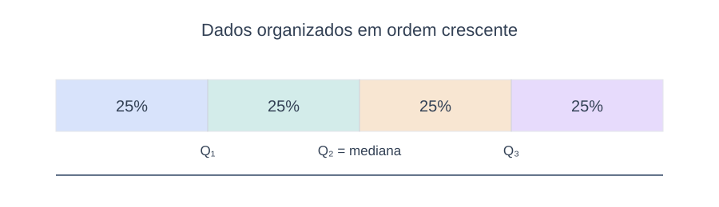
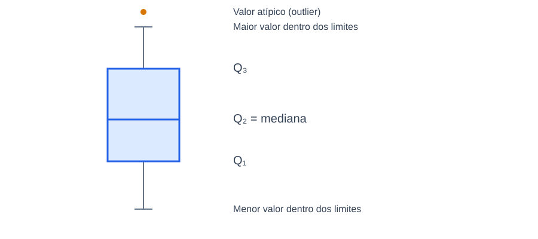

# 3.1.3. Medidas de Posição

As medidas de posição são usadas para determinar a posição de uma observação em relação às outras. Aqui, exploraremos duas delas: os quartis e os percentis.

### 3.1.3.1. Quartis

Os quartis são as medidas que dividem um conjunto de dados, inicialmente organizados em ordem crescente, em quatro partes iguais. O primeiro quartil ($Q_1$), também chamado de quartil inferior, delimita, aproximadamente, 25% dos menores valores; o segundo quartil ($Q_2$) divide o conjunto ao meio e, por isso, o seu valor é equivalente ao da mediana ($Md$); e, por fim, o terceiro quartil ($Q_3$), também chamado de quartil superior, delimita, aproximadamente, 25% dos maiores valores (Figura 10).

A amplitude interquartil ($AIQ$), também denominada de intervalo interquartílico, é a diferença entre o terceiro e o primeiro quartil, ou seja:

$$AIQ = Q_3 - Q_1$$

Essa medida de variabilidade expressa a amplitude da faixa na qual se concentram 50% dos valores centrais do conjunto de dados.

### 3.1.3.2. Percentis

Os percentis são medidas que dividem um conjunto de dados ordenados em cem partes iguais. Cada conjunto de dados possui 99 percentis, representados por $P_1, P_2, \dots, P_{99}$, de forma que o $k$-ésimo percentil ($P_k$) delimita, aproximadamente, $k\%$ dos menores valores e $(100-k)\%$ dos maiores valores.

Por exemplo, o 25º percentil ($P_{25}$) equivale ao primeiro quartil ($Q_1$), o 50º percentil ($P_{50}$) equivale ao segundo quartil ($Q_2$) ou mediana ($Md$), e o 75º percentil ($P_{75}$) equivale ao terceiro quartil ($Q_3$).

---

### 3.1.3.3. BoxPlot

O boxplot é uma representação gráfica que nos ajuda a visualizar o centro, a dispersão e a assimetria de um conjunto de dados. Nesse gráfico, incluímos os três quartis e, também, o maior e o menor valor presente no conjunto de dados delimitado pela borda interna inferior ($BII$) e pela borda interna superior ($BIS$). Esses valores, que são denominados “bigodes”, representam a variabilidade fora do quartil superior e do quartil inferior, respectivamente.

O boxplot pode ser desenhado de forma horizontal ou vertical, ambas com o formato de “caixa e haste” (Figura 11). A construção se resume em cinco etapas (MANN, 2015):

**Etapa 1** – Ordenar os dados em ordem crescente e calcular os valores dos três quartis e da amplitude interquartil ($AIQ = Q_3 - Q_1$).

**Etapa 2** – Identificar as bordas internas inferior e superior:  
* Borda interna inferior ($BII$):  
$$BII = Q_1 - (1{,}5 \times AIQ)$$  
* Borda interna superior ($BIS$):  
$$BIS = Q_3 + (1{,}5 \times AIQ)$$

**Etapa 3** – Determinar o menor e o maior valor do conjunto de dados que estejam dentro dos limites das bordas internas.

**Etapa 4** – Traçar um segmento de reta vertical que contenha, no mínimo, a amplitude do conjunto de dados. Ao lado dele, desenhar uma caixa delimitada pelo primeiro e pelo terceiro quartil, e dentro traçar uma linha horizontal na posição da mediana ou segundo quartil.

**Etapa 5** – Traçar um segmento de reta unindo o maior e o menor valor dentro dos limites das bordas internas. Os dois segmentos formados pela interseção desses valores com a caixa são chamados de bigodes. Um valor que se posiciona fora das duas bordas internas é considerado um *outlier* (valor discrepante) e identificado por um asterisco ou ponto destacado.

---

### Exemplo Prático: Boxplots de PETR4 e VALE3

Consideremos os dados dos preços das ações da Petrobrás e da Vale do Rio Doce no 1º de março entre 2009 e 2018 (Exemplo 3.1.4):

* **Petrobrás (em rol):** 5, 9, 13, 16, 17, 21, 25, 25, 28, 35.  
  - $Md = Q_2 = \frac{17 + 21}{2} = 19{,}00$  
  - $Q_1 = 13{,}00$  
  - $Q_3 = 25{,}00$  
  - $AIQ = 25 - 13 = 12{,}00$  
  - $BII = 13 - (1{,}5 \times 12) = 13 - 18 = -5$  
  - $BIS = 25 + (1{,}5 \times 12) = 25 + 18 = 43$  
  - Menor valor dentro dos limites: 5. Maior valor: 35. Nenhum valor está fora de $[-5, 43]$, portanto não há outliers.

* **Vale do Rio Doce (em rol):** 13, 21, 29, 32, 33, 37, 44, 44, 51, 55.  
  - $Md = Q_2 = \frac{33 + 37}{2} = 35{,}00$  
  - $Q_1 = 29{,}00$  
  - $Q_3 = 44{,}00$  
  - $AIQ = 44 - 29 = 15{,}00$  
  - $BII = 29 - (1{,}5 \times 15) = 29 - 22{,}5 = 6{,}5$  
  - $BIS = 44 + (1{,}5 \times 15) = 44 + 22{,}5 = 66{,}5$  
  - Menor valor dentro dos limites: 13. Maior valor: 55. Não há outliers.

A Figura 8 do livro ilustra a comparação dos boxplots para as duas empresas:

**Interpretação comparativa:**
* A mediana das ações da Petrobrás foi de R$ 19,00, o que significa que 50% dos valores do período estão abaixo dela. Já a mediana das ações da Vale foi de R$ 35,00;
* As ações da Petrobrás apresentaram $Q_1 = 13$ e $Q_3 = 25$, ou seja, aproximadamente 50% dos valores estiveram entre R$ 13,00 e R$ 25,00 no período analisado. Já as ações da Vale apresentaram $Q_1 = 29$ e $Q_3 = 44$;
* Não há presença de outliers, uma vez que nenhum dos valores foi classificado fora das bordas internas calculadas;
* Os valores máximo e mínimo para as ações da Petrobrás no conjunto analisado foram de R$ 35,00 e R$ 5,00, respectivamente. Para as ações da Vale, foram de R$ 55,00 e R$ 13,00.
