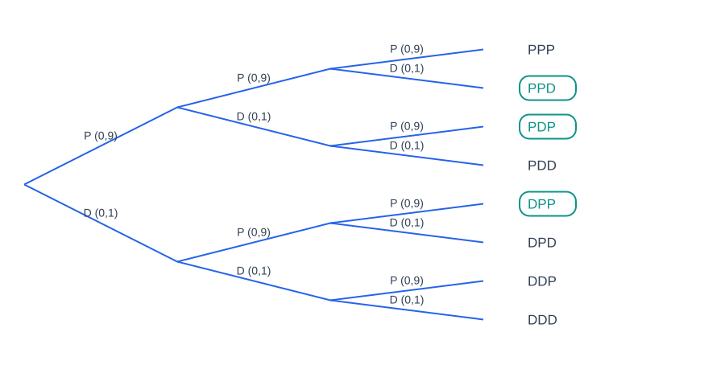

# CAPÍTULO 5 - DISTRIBUIÇÕES DE PROBABILIDADES DE VARIÁVEIS ALEATÓRIAS DISCRETAS

Vimos que variáveis aleatórias são variáveis que possuem seus valores determinados pelos resultados de experimentos aleatórios e que podem ser classificadas em discretas e contínuas de acordo com os valores assumidos. Neste capítulo, trataremos sobre as distribuições de probabilidades de variáveis aleatórias discretas, ou seja, aquelas cujos valores são inteiros e contáveis.

Uma distribuição de probabilidades discreta nada mais é do que a apresentação de todos os valores possíveis que uma variável pode assumir juntamente com suas probabilidades correspondentes. Como vimos no capítulo anterior, as propriedades de probabilidades também se aplicam aqui, ou seja, a probabilidade de um evento será sempre um valor no intervalo $[0, 1]$ e a soma das probabilidades de todos os eventos simples é igual a 1.

Considere, por exemplo, o número de defeitos (por mês) em uma máquina de tecelagem de uma grande empresa, com base em dados coletados no passado (Tabela 5).

**Tabela 5 – Número de defeitos ao mês de uma máquina de tecelagem**

| Defeitos por mês ($x$) | Frequência | Frequência Relativa $P(x)$ |
| :---: | :---: | :---: |
| 0 | 20 | 0,17 |
| 1 | 50 | 0,42 |
| 2 | 30 | 0,25 |
| 3 | 15 | 0,12 |
| 4 | 5 | 0,04 |
| **Total** | **$N = 120$** | **$\Sigma = 1{,}00$** |

Com base na tabela acima, podemos saber a probabilidade de a máquina ter apresentado $x$ defeitos em um determinado mês. Por exemplo, a probabilidade de que a máquina tenha apresentado dois defeitos em um dado mês selecionado ao acaso é igual a 0,25. De maneira semelhante, a probabilidade de que tenha apresentado mais de dois defeitos pode ser calculada como:

$$P(x > 2) = P(x = 3) + P(x = 4) = 0{,}12 + 0{,}04 = 0{,}16$$

ou pelo complemento:

$$P(x > 2) = 1 - P(x \le 2) = 1 - [P(x = 0) + P(x = 1) + P(x = 2)] = 1 - [0{,}17 + 0{,}42 + 0{,}25] = 1 - 0{,}84 = 0{,}16$$

A distribuição de probabilidades da Tabela 5 também pode ser apresentada graficamente (Figura 10) de maneira semelhante a um gráfico de distribuição de frequências. No eixo $x$ são apresentadas as quantidades de defeitos ($x$); e no $y$, a probabilidade para cada valor de $x$ ($P(x)$).

---

### Média e Desvio-Padrão de Variáveis Discretas

* **Média aritmética (Valor Esperado):** A média aritmética ($\mu$) de uma variável aleatória discreta ($X$) expressa o valor esperado ($E(X)$) após repetir o experimento um grande número de vezes e é calculada por:

$$\mu = E(X) = \sum x \cdot P(x)$$

* **Desvio-padrão:** Mede a dispersão de sua distribuição de probabilidades e é calculado por:

$$\sigma = \sqrt{\sum x^2 \cdot P(x) - \mu^2}$$

Calculando para os dados da máquina de tecelagem:
* $\mu = (0 \times 0{,}17) + (1 \times 0{,}42) + (2 \times 0{,}25) + (3 \times 0{,}12) + (4 \times 0{,}04) = 0 + 0{,}42 + 0{,}50 + 0{,}36 + 0{,}16 = 1{,}44$ defeitos/mês.
* $\sum x^2 P(x) = (0^2 \times 0{,}17) + (1^2 \times 0{,}42) + (2^2 \times 0{,}25) + (3^2 \times 0{,}12) + (4^2 \times 0{,}04) = 0 + 0{,}42 + 1{,}00 + 1{,}08 + 0{,}64 = 3{,}14$.
* $\sigma = \sqrt{3{,}14 - (1{,}44)^2} = \sqrt{3{,}14 - 2{,}0736} = \sqrt{1{,}0664} \cong 1{,}03$ defeitos.

---

## 5.1. Distribuição Binomial de Probabilidades

A distribuição binomial é aplicada a experimentos que consistem de uma sequência de ensaios idênticos e independentes conhecidos como **ensaios de Bernoulli**. Cada ensaio possui apenas dois resultados possíveis: "Sucesso" (com probabilidade $p$) ou "Fracasso" (com probabilidade $q = 1 - p$).

**Exemplo 5.1.1.** Um inspetor de qualidade de uma montadora inspeciona 3 notebooks produzidos na linha de montagem da FATEC. Sabe-se por histórico que 10% dos notebooks fabricados apresentam algum defeito ($p = 0{,}10$). Seja $D$ o evento "apresenta defeito" ($p = 0{,}10$) e $P$ "perfeito" ($q = 0{,}90$).

O experimento de testar 3 notebooks pode ser representado pelo diagrama de árvore a seguir:

Dessa forma, como os três testes são independentes, podemos descobrir a probabilidade de cada resultado final por meio da multiplicação das probabilidades de cada teste. Se quiséssemos a probabilidade de que todos os 3 apresentem defeito:

$$P(DDD) = (0{,}1) \cdot (0{,}1) \cdot (0{,}1) = 0{,}001$$

Para a probabilidade de que exatamente 1 notebook apresente defeito, observamos na Figura 11 os ramos circulados: $PPD$, $PDP$ e $DPP$:
* $P(PPD) = (0{,}9) \cdot (0{,}9) \cdot (0{,}1) = 0{,}081$
* $P(PDP) = (0{,}9) \cdot (0{,}1) \cdot (0{,}9) = 0{,}081$
* $P(DPP) = (0{,}1) \cdot (0{,}9) \cdot (0{,}9) = 0{,}081$
* Soma: $P(X = 1) = 0{,}081 + 0{,}081 + 0{,}081 = 3 \times 0{,}081 = 0{,}243 \quad (24{,}3\%)$.

De forma genérica, o número de caminhos com $x$ sucessos em $n$ ensaios é dado pela combinação $C_{n, x} = \binom{n}{x}$.

### Função de Probabilidade Binomial

$$P(X = x) = \binom{n}{x} p^x (1-p)^{n-x} = \frac{n!}{x! \, (n-x)!} p^x (1-p)^{n-x}$$

* **Média:**
$$\mu = n \cdot p$$

* **Variância:**
$$\sigma^2 = n \cdot p \cdot (1-p)$$

* **Desvio-Padrão:**
$$\sigma = \sqrt{n \cdot p \cdot (1-p)}$$
