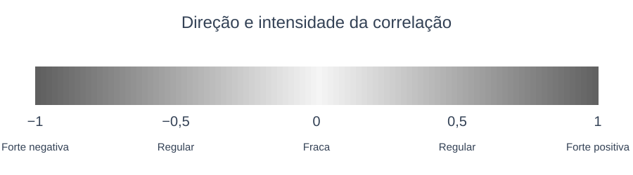

# 7.1.2. Coeficiente de Determinação

O coeficiente de determinação avalia quão bom é um modelo de regressão, ou seja, com que precisão a variável independente explica a variável dependente. Quando calculado para dados de população é representado por $\rho^2$, já para dados de amostra é representado por $R^2$. O valor do coeficiente varia de zero a um, sendo que quanto mais alto, melhor o modelo avaliado.

> **Coeficiente de Determinação:** A fórmula de cálculo para $r^2$ é:
> 
> $$r^2 = \frac{b \cdot SQ_{XY}}{SQ_Y} \qquad 0 \le r^2 \le 1$$

**Exemplo 7.1.2.** Calcule o coeficiente de determinação para o modelo do Exemplo 7.1.1. e interprete-o.

$$r^2 = \frac{b \cdot SQ_{XY}}{SQ_Y} = \frac{-7{,}29 \cdot -481}{3568{,}9} = 0{,}98$$

**Tabela auxiliar do cálculo da $SQ_Y$:**

| $y$ | $y^2$ |
| :-: | :-: |
| 51 | 2601 |
| 82 | 6724 |
| 64 | 4096 |
| 40 | 1600 |
| 56 | 3136 |
| 38 | 1444 |
| 94 | 8836 |
| 86 | 7396 |
| 72 | 5184 |
| 46 | 2116 |
| **$\Sigma y = 629$** | **$\Sigma y^2 = 43133$** |

$$SQ_Y = \Sigma y^2 - \frac{(\Sigma y)^2}{n}$$

$$SQ_Y = 43133 - \frac{(629)^2}{10}$$

$$SQ_Y = 43133 - \frac{395641}{10}$$

$$SQ_Y = 3568{,}9$$

Dessa forma, $r^2 = 0{,}98$, ou seja, 98% da variação total na taxa de depreciação de veículos ocorre em razão da variação em seu tempo de uso. Os 2% remanescentes são decorrentes da aleatoriedade e de outras variáveis.

---

# 7.2. Análise de Correlação

O coeficiente de correlação linear mede a força da associação linear entre duas variáveis, ou seja, quão próximos à reta de regressão linear estão os pontos de um diagrama de dispersão. Ele é representado por $\rho$ caso seja calculado para os dados de uma população ou $r$ no caso de uma amostra.

O valor desse coeficiente se posiciona sempre no intervalo fechado entre -1 e 1, o que significa que pode ser uma correlação negativa perfeita ou positiva perfeita, respectivamente. Nesses casos, os pontos do diagrama de dispersão encontram-se exatamente sobre a linha de regressão. Já quando os pontos estão dispersos, a correlação é fraca, podendo até não haver correlação linear entre as variáveis. Nesse último caso, o valor do coeficiente de correlação encontra-se próximo a zero.

**Cálculo do coeficiente de correlação:**

$$r = \frac{SQ_{XY}}{\sqrt{SQ_X \cdot SQ_Y}}$$

tal que,

$$SQ_{XY} = \Sigma xy - \frac{(\Sigma x)(\Sigma y)}{n}$$

$$SQ_X = \Sigma x^2 - \frac{(\Sigma x)^2}{n} \qquad \text{e} \qquad SQ_Y = \Sigma y^2 - \frac{(\Sigma y)^2}{n}$$

*\* $SQ$: soma de quadrados*

Dessa forma, a interpretação do coeficiente de correlação pode ser feita utilizando a seguinte escala de intensidade:

**Exemplo 7.2.1.** Calculemos o coeficiente de correlação do Exemplo 7.1.1. envolvendo as variáveis tempo de uso ($x$) e preço ($y$) de veículos à venda no mercado.

$$SQ_{XY} = -481$$

$$SQ_X = 66$$

$$SQ_Y = \Sigma y^2 - \frac{(\Sigma y)^2}{n} = 43133 - \frac{395641}{10} = 3568{,}9$$

Assim,

$$r = \frac{SQ_{XY}}{\sqrt{SQ_X \cdot SQ_Y}} = \frac{-481}{\sqrt{66 \times 3568{,}9}} = -0{,}9911$$

Consequentemente, o coeficiente de correlação ($r = -0{,}99$) indica relação inversa de grau forte entre as variáveis “tempo de uso” e “preço de venda” de veículos, ou seja, a dispersão dos pontos em relação à linha de regressão é muito pequena.
